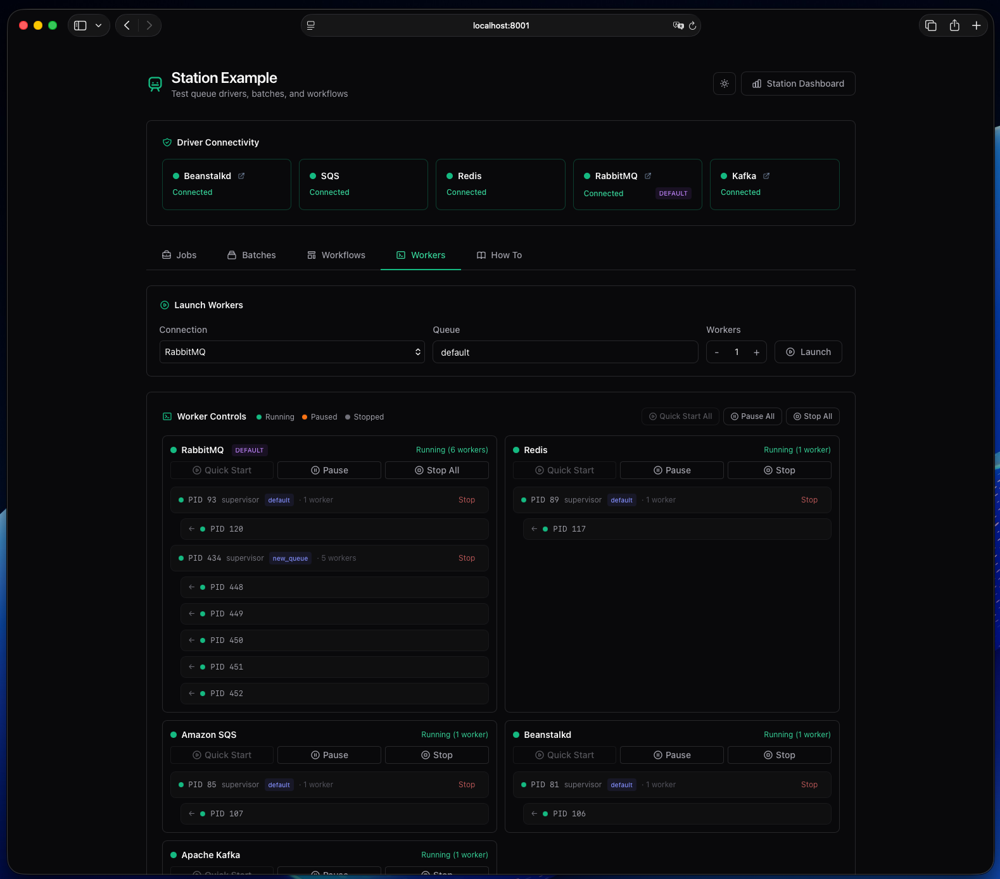
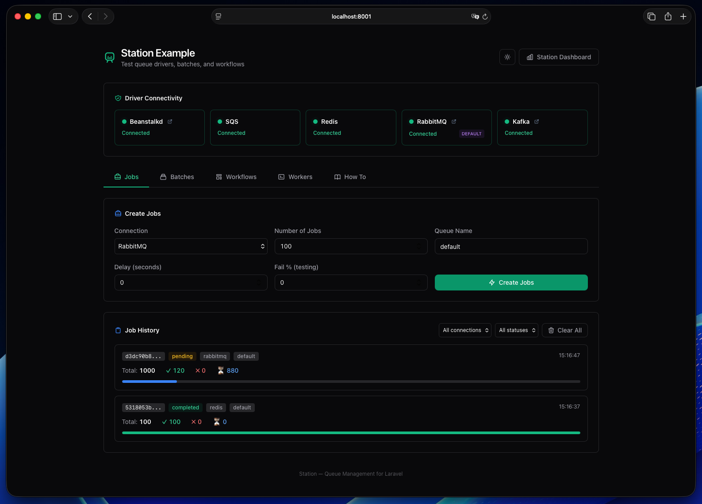
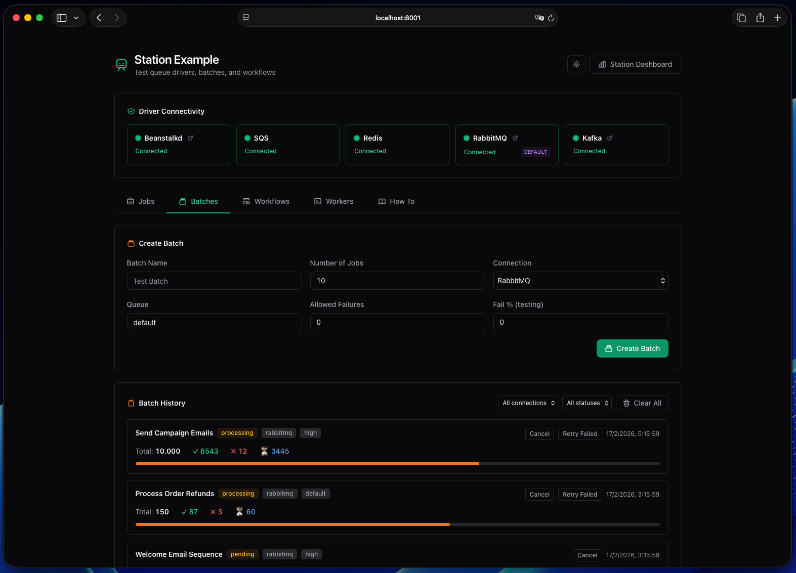
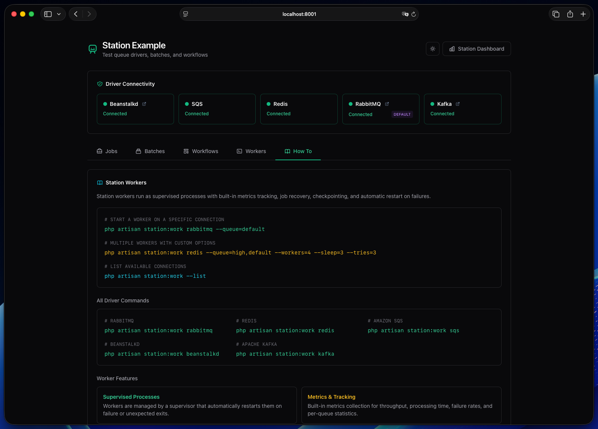
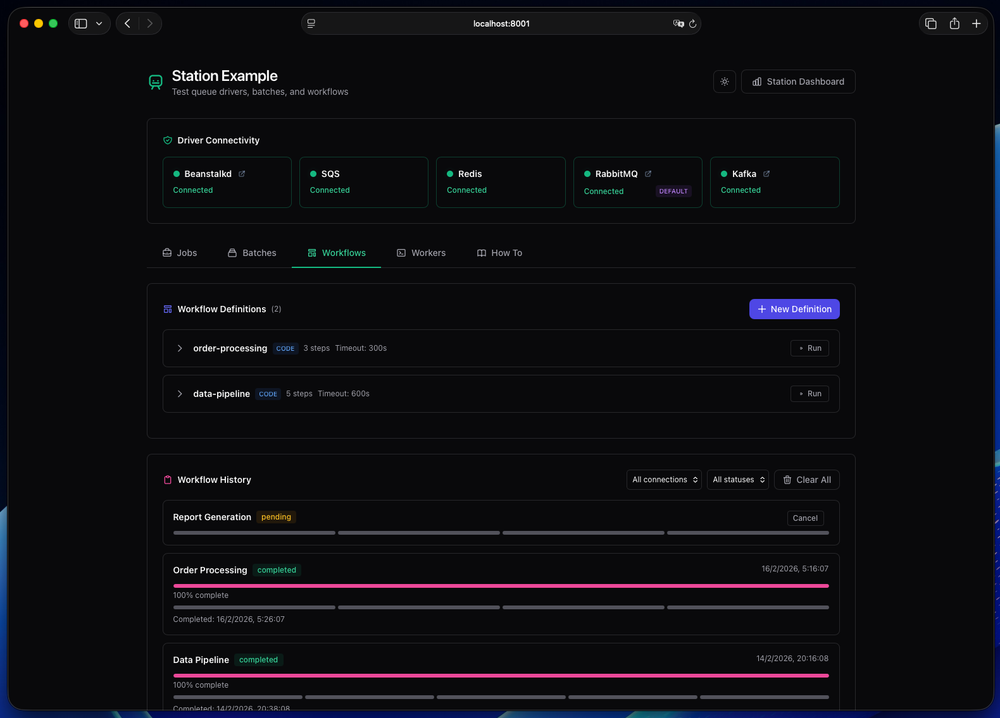
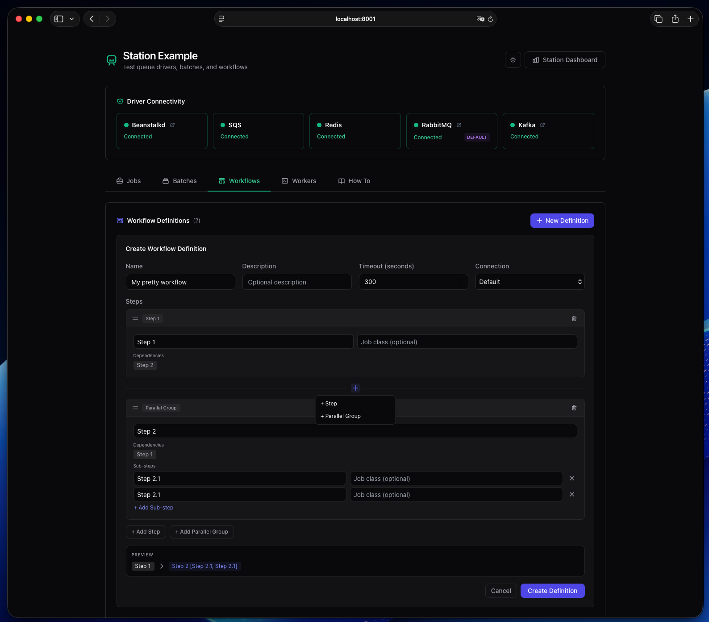

# Station Example Application

> **Warning:** This example app has no authentication. All routes — including worker control,
> queue management, and data deletion — are publicly accessible. **Do not expose it to the internet.**

A Laravel application for testing and demonstrating [Station](https://github.com/ojbaeza/station) — a multi-driver queue management package for Laravel.

Dispatch jobs, batches, and workflows across all five supported drivers (RabbitMQ, Redis, SQS, Beanstalkd, Kafka) from a web interface, then monitor them through the Station dashboard.



## Prerequisites

This app runs inside its own Docker container and connects to the queue services provided by the [Station Docker environment](https://github.com/ojbaeza/station). Start those services first from the **Station root directory**:

```bash
docker compose up -d
```

Then create the example database:

```bash
docker exec station_mysql mysql -uroot -proot -e "CREATE DATABASE IF NOT EXISTS station_example; GRANT ALL ON station_example.* TO 'station'@'%';"
```

> **Note:** The example container joins the `station_station` external Docker network. If the Station services aren't running, `docker compose up` in `example/` will fail with a network error.

## Quick Start

### 1. Start the Example Container

From the Station root:

```bash
cd example
docker compose up -d
```

### 2. Setup (one command)

```bash
docker exec station_example composer setup
```

This installs dependencies, copies `.env.example` to `.env` (if needed), generates an app key, publishes Station assets, and runs migrations.

<details>
<summary>Or run the steps manually</summary>

```bash
docker exec station_example composer install
docker exec station_example cp .env.example .env
docker exec station_example php artisan key:generate
docker exec station_example php artisan vendor:publish --tag=station-assets --force
docker exec station_example php artisan migrate
```
</details>

### 3. Seed Demo Data (optional)

Populates all Station tables with realistic data for screenshots and exploring the dashboard:

```bash
docker exec station_example php artisan migrate:fresh --seed
```

> This runs a fresh migration before seeding, so it replaces whatever `migrate` created in step 2.

### 4. Open the Dashboards

- **Example App:** http://localhost:8001
- **Station Dashboard:** http://localhost:8001/station

## Starting Workers

Start Station workers inside the example container:

```bash
# Start workers for a specific driver
docker exec station_example php artisan station:work rabbitmq --queue=default
docker exec station_example php artisan station:work redis --queue=default
docker exec station_example php artisan station:work sqs --queue=default
docker exec station_example php artisan station:work beanstalkd --queue=default
docker exec station_example php artisan station:work kafka --queue=default

# List available connections
docker exec station_example php artisan station:work --list
```

> The `database` and `sync` drivers don't need workers — jobs run inline or via the standard `queue:work` command.

## Features

- **Multi-Driver Testing** — Dispatch jobs to RabbitMQ, Redis, SQS, Beanstalkd, Kafka, or Database
- **Job Dispatching** — Send 1 to 100,000 jobs with configurable delay and failure rate
- **Batch Creation** — Create batches with progress tracking and allowed failure thresholds
- **Failed Jobs** — View, retry, and delete failed jobs across all drivers
- **Queue Pause/Resume** — Pause and resume queues per connection
- **Workflow Editor** — Define DAG workflows with steps, parallel groups, and dependencies from the UI
- **Workflow Definitions** — Create, edit, and manage reusable workflow templates
- **Worker Management** — Launch, pause, and stop workers per connection from the browser
- **Driver Connectivity** — Visual status for each driver's connection health
- **Station Dashboard** — Full monitoring UI at `/station` with metrics, alerts, and audit log

| Jobs                               | Batches                                  | How To                                 |
| ---------------------------------- | ---------------------------------------- | -------------------------------------- |
|  |  |  |

| Workflows                                    | Workflow Editor                                          |
| -------------------------------------------- | -------------------------------------------------------- |
|  |  |

## Environment Variables

Key Station settings in `.env` (see `.env.example` for all options):

| Variable | Default | Description |
| --- | --- | --- |
| `QUEUE_CONNECTION` | `rabbitmq` | Default queue driver |
| `STATION_PROCESS_MANAGEMENT` | `true` | Enable worker management from the dashboard |
| `STATION_API_AUTH` | `none` | API auth mode (`none` or `token`) |
| `STATION_API_TOKEN` | — | Required when `STATION_API_AUTH=token` |

## Testing

```bash
docker exec station_example php artisan test
```

## Docker Services

The example container connects to the Station Docker network (`station_station`) for access to all queue services:

| Service    | Container          | Port        | Purpose          |
| ---------- | ------------------ | ----------- | ---------------- |
| Example    | station_example    | 8001        | Web UI & workers |
| RabbitMQ   | station_rabbitmq   | 5672, 15672 | Message queue    |
| Redis      | station_redis      | 6379        | In-memory store  |
| LocalStack | station_localstack | 4566        | SQS emulation    |
| Beanstalkd | station_beanstalkd | 11300       | Job queue        |
| Kafka      | station_kafka      | 9092        | Event streaming  |
| MySQL      | station_mysql      | 3306        | Database         |

## Troubleshooting

### Clear caches

```bash
docker exec station_example php artisan config:clear
docker exec station_example php artisan cache:clear
```

### Check driver connectivity

Visit http://localhost:8001 — the Driver Connectivity panel shows the status of each connection.

### View logs

```bash
docker exec station_example tail -f storage/logs/laravel.log
```

### Rebuild example container

```bash
docker compose down
docker compose up -d --build
```

### Shell access

```bash
docker exec -it station_example bash
```
